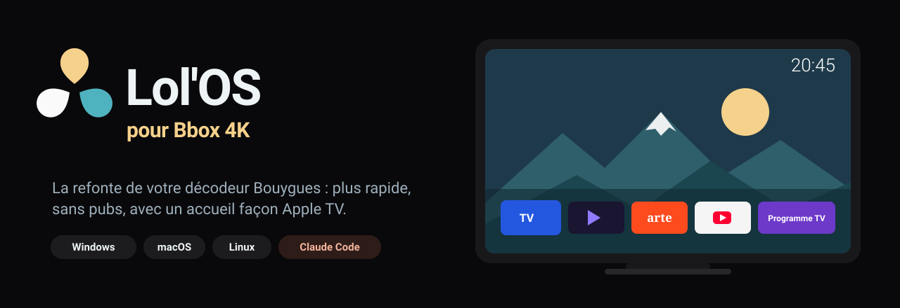
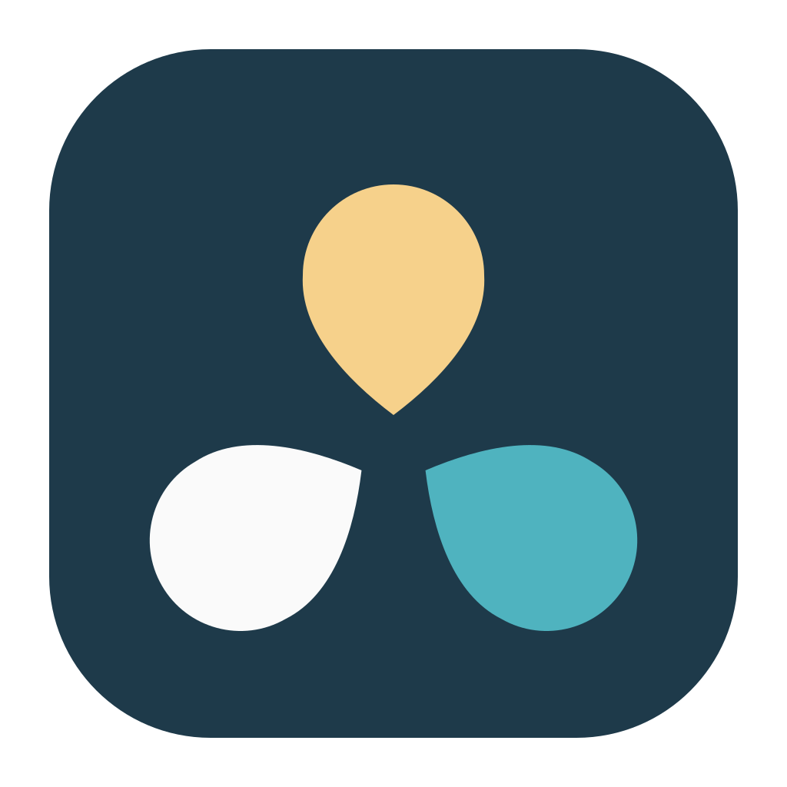
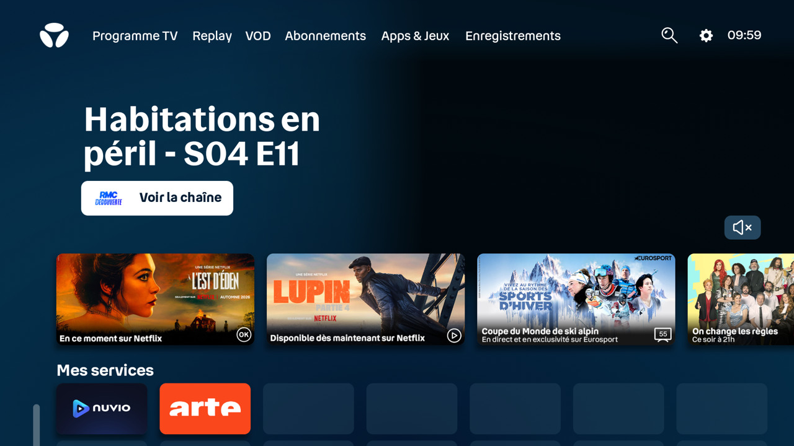
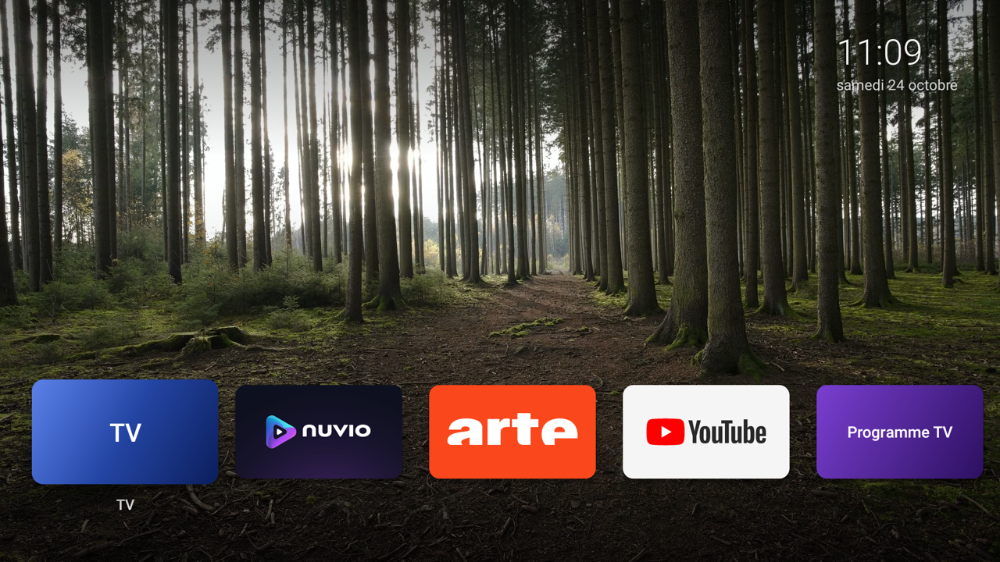
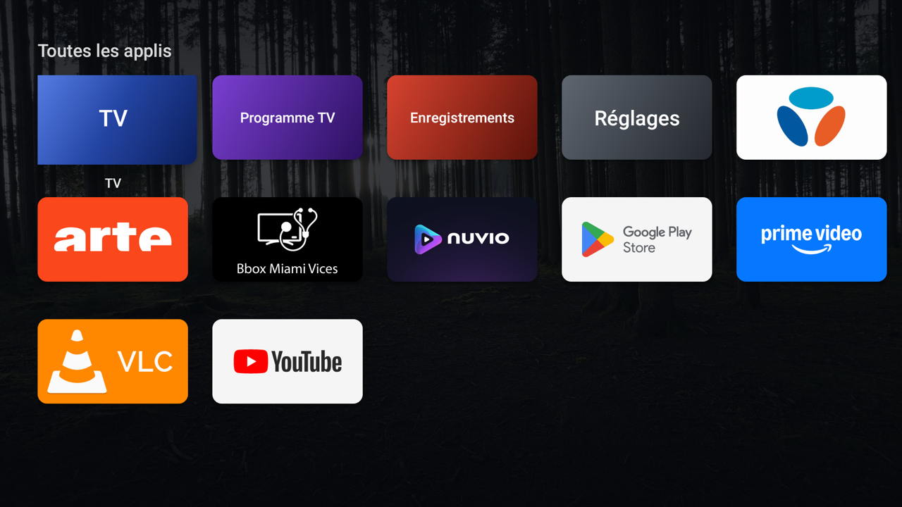
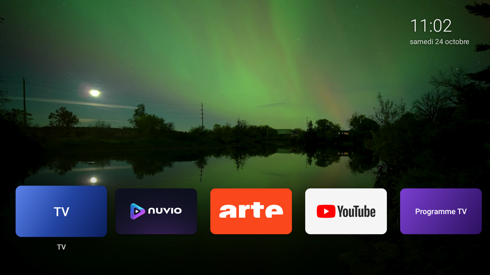
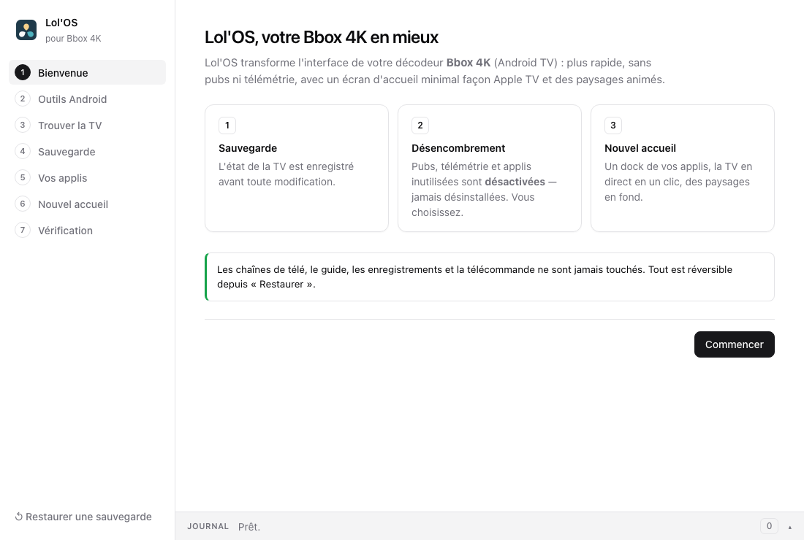
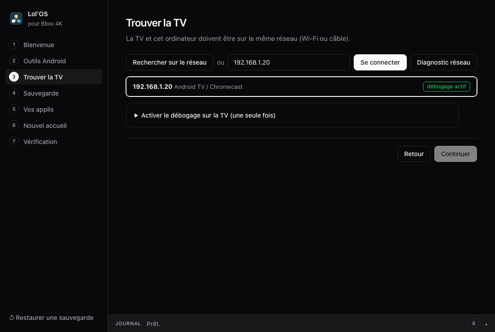
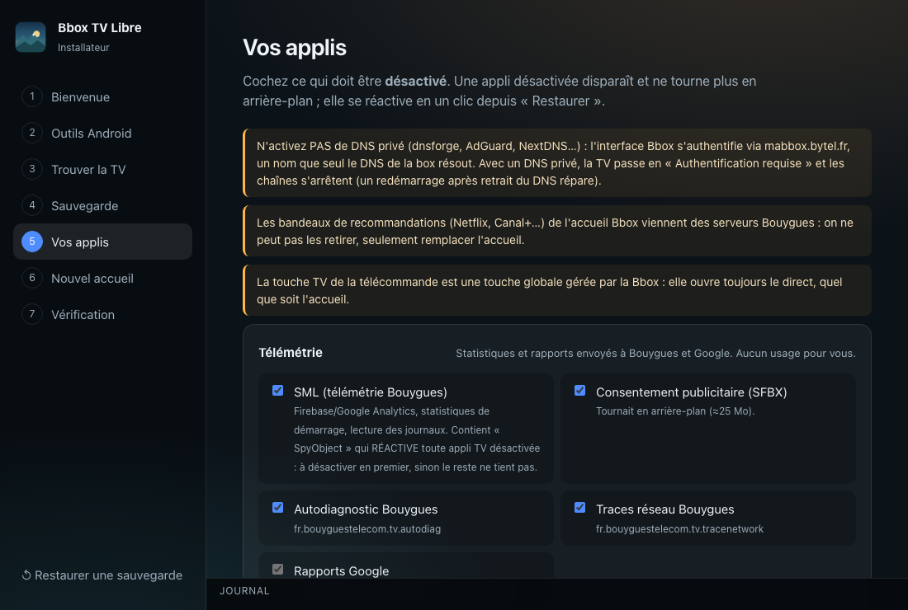
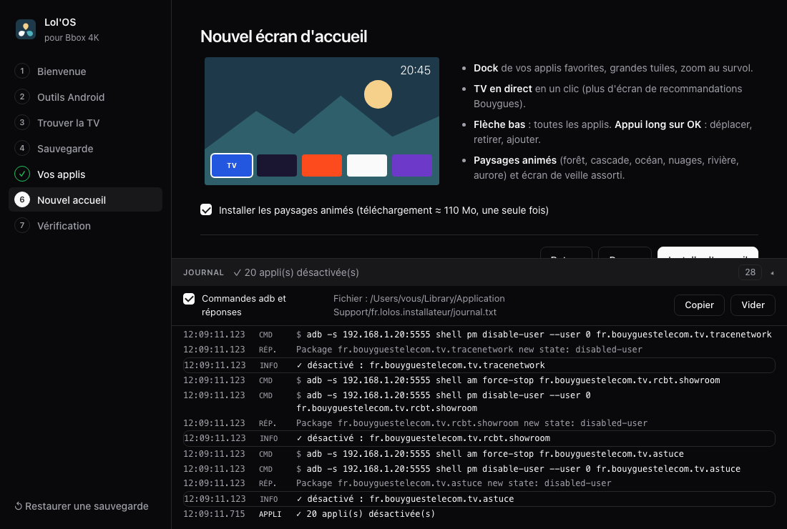

<p align="center">
  
</p>

<p align="center">
  
</p>

<p align="center">
  <a href="../../releases/latest"><b>⬇️ Télécharger Lol'OS</b></a> ·
  <a href="#utiliser-lolos-sans-claude">Mode d'emploi</a> ·
  <a href="#avec-claude-code">Avec Claude Code</a> ·
  <a href="#comment-ça-marche">Comment ça marche</a> ·
  <a href="#revenir-en-arrière">Revenir en arrière</a>
</p>

# Lol'OS — votre Bbox 4K, en mieux

Votre décodeur **Bbox 4K de Bouygues Telecom** (Android TV) est **lent**, rempli de **pubs** et de
**recommandations** (Netflix, Canal+…), et fait tourner en permanence des applis que vous n'utilisez pas ?

**Lol'OS** refait son interface en quelques minutes, depuis votre ordinateur (Windows, Mac ou Linux) :

- 🧹 **Désencombrement** : pubs, télémétrie et applis inutilisées sont **désactivées** — jamais désinstallées — et
  c'est **vous qui choisissez** lesquelles.
- ⚡ **Plus rapide** : animations accélérées, applis en arrière-plan coupées. Mesuré sur une Bbox 4K :
  **+25 % de mémoire libre** (465 → 581 Mo).
- 🏔️ **Nouvel écran d'accueil façon Apple TV** : un dock de vos applis, la **TV en direct en un clic**, plus aucun
  bandeau de recommandations, et des **paysages animés** en fond (forêt, cascade, océan, nuages, rivière, aurore
  boréale), avec l'écran de veille assorti.
- ✍️ **À votre image** : message d'accueil (« Bonsoir Lolo ») et écran de démarrage avec votre logo.
- ⏻ **Redémarrer ou mettre en veille** la box depuis l'accueil, sans root.
- 💾 **Sauvegarde automatique** avant toute modification et **restauration en un clic**.
- 🔄 **Mises à jour automatiques** de l'installateur et de l'accueil de la TV.
- 📺 **Les chaînes de télé ne sont jamais touchées** : direct, guide des programmes, enregistrements, télécommande.

| Avant : l'accueil Bbox | Après : Lol'OS |
|---|---|
|  |  |
|  |  |

> ⚠️ Projet personnel, **non affilié à Bouygues Telecom**. « Bbox » est une marque de Bouygues Telecom.
> Tout est réversible, mais vous l'utilisez à vos risques.

---

## Utiliser Lol'OS sans Claude

### 1. Télécharger l'installateur

Rendez-vous dans les [**versions (Releases)**](../../releases/latest) et prenez le fichier de votre système :

| Système | Fichier |
|---|---|
| **Windows 10 / 11** | `LolOS_…_x64-setup.exe` (ou `.msi`) |
| **macOS** (Apple Silicon et Intel) | `LolOS_…_universal.dmg` |
| **Linux** | `LolOS_…_amd64.AppImage` (ou `.deb`) |

L'installateur n'est pas signé (projet bénévole) :
- **Windows** : si SmartScreen s'affiche, cliquez sur *Informations complémentaires* → *Exécuter quand même*.
- **macOS** : *clic droit → Ouvrir*. Si macOS dit que l'appli est « endommagée » :
  `xattr -cr /Applications/LolOS.app` dans le Terminal.
- **Linux** : `chmod +x LolOS_*.AppImage` puis lancez-le.

### 2. Préparer la TV (une seule fois)

1. Sur la TV : **Paramètres** → **Préférences de l'appareil** → **À propos**.
2. Descendez sur **Build** et appuyez **7 fois sur OK** (« Vous êtes maintenant développeur »).
3. Retour → **Options pour les développeurs** → activez **Débogage USB** (et **Débogage réseau** s'il existe).

La TV et l'ordinateur doivent être sur le **même réseau** (Wi-Fi ou câble, sans VPN).

### 3. Suivre l'assistant

L'installateur vous guide étape par étape :

1. **Outils Android** — il cherche `adb` ; s'il n'est pas installé, un bouton l'installe automatiquement
   (outils officiels Google, ~7 Mo, sans droits administrateur), ou il vous donne la commande pour votre système.
2. **Trouver la TV** — recherche automatique sur le réseau (ou saisissez son adresse IP). À la première
   connexion, la TV demande « Autoriser le débogage ? » : cochez *Toujours autoriser* puis **OK**.
3. **Sauvegarde** — l'état de la TV est enregistré.
4. **Vos applis** — cochez ce que vous voulez désactiver (pubs et télémétrie sont précochées).
5. **Nouvel accueil** — installe Lol'OS et les paysages.
6. **Personnaliser** — message d'accueil (`{moment}` devient Bonjour / Bon après-midi / Bonsoir), écran de
   démarrage avec votre image, aperçu immédiat sur la TV.
7. **Vérification** — capture d'écran de la TV et test du direct.

L'installateur se **met à jour tout seul** (bandeau « Lol'OS x.y est disponible ») et propose de **mettre à jour
l'accueil de la TV** quand il en livre une version plus récente — vos réglages sont conservés. En bas à gauche :
**Redémarrer la box**.

Le **journal** en bas de la fenêtre s'ouvre d'un clic et affiche en direct chaque commande envoyée à la TV.

| Bienvenue | Recherche de la TV |
|---|---|
|  |  |
| **Choix des applis** | **Journal en direct** |
|  |  |

### En ligne de commande

Pour les habitués du terminal, `cli/lolos.py` fait la même chose (Python 3.8+, aucune dépendance) :

```bash
python3 cli/lolos.py chercher            # trouve la TV sur le réseau
python3 cli/lolos.py connecter 192.168.1.x
python3 cli/lolos.py sauvegarder         # toujours en premier
python3 cli/lolos.py lister              # applis du profil présentes sur la TV
python3 cli/lolos.py appliquer --interactif     # vous demande, catégorie par catégorie
python3 cli/lolos.py accueil             # installe l'écran d'accueil et les paysages
python3 cli/lolos.py verifier --direct   # vérifie tout, y compris la TV en direct
python3 cli/lolos.py restaurer           # remet la TV comme avant
```

Personnalisation et options (toutes facultatives) :

```bash
python3 cli/lolos.py personnaliser --message "{moment} Lolo" --logo image.png --apercu
python3 cli/lolos.py personnaliser --meteo Lyon --mode-nuit oui --nettoyage-memoire oui --infos-systeme oui
python3 cli/lolos.py fonds --ajouter vacances.jpg feu-de-cheminee.mp4   # vos fonds d'écran
python3 cli/lolos.py veille --profonde 24h                               # 1h (Bouygues), 24h ou jamais
python3 cli/lolos.py redemarrer
```

Le détail des options est dans [`docs/personnalisation.md`](docs/personnalisation.md).
`--simulation` montre ce qui serait fait sans rien changer, `--json` donne une sortie lisible par un programme.
Si `adb` manque, le script propose de l'installer.

---

## Avec Claude Code

Lol'OS a été **entièrement conçu avec [Claude Code](https://claude.com/claude-code)** (Claude, d'Anthropic), et il
est livré avec de quoi refaire la même chose en discutant avec Claude :

```bash
git clone https://github.com/lxwiq/lolos-bbox-4k.git
cd lolos-bbox-4k
claude
```

Puis demandez simplement : *« Désencombre ma Bbox et installe Lol'OS »*. Le skill
[`.claude/skills/lolos`](.claude/skills/lolos/SKILL.md) et le fichier [`CLAUDE.md`](CLAUDE.md) donnent à Claude
toute la méthode : trouver la TV, **sauvegarder d'abord**, **vous demander** quelles applis vous utilisez, appliquer,
installer l'accueil, puis **vérifier par des captures d'écran** de la TV. Claude ne saisit jamais vos identifiants
Bouygues et ne désinstalle rien.

### Comment le projet a été fait

Tout est parti d'une demande à Claude Code : *« Ma TV est lente et pleine de pubs, trouve-la sur mon Wi-Fi,
connecte-toi en ADB et désencombre-la, de façon réversible, en me demandant d'abord ; puis construis un écran
d'accueil minimal façon Apple TV avec des fonds animés »*. Dans la même session, Claude a :

- trouvé la TV sur le réseau, contourné la protection « Réseau local » de macOS, et **sauvegardé** son état ;
- classé ses 136 applis et **posé les questions** avant de toucher à ce qui pouvait servir ;
- découvert, en **désassemblant les applis système**, pourquoi les désactivations ne tenaient pas, pourquoi un DNS
  bloqueur de pubs coupait les chaînes, et comment ouvrir le direct sans passer par les recommandations
  (voir ci-dessous) ;
- écrit le lanceur Android, sélectionné et monté en boucle les vidéos libres de droits, testé chaque étape
  par des **captures d'écran de la TV** et un vrai **redémarrage** ;
- testé le **script de restauration pour de vrai**, puis écrit cet installateur, le CLI et ce README.

---

## Comment ça marche

Lol'OS parle à la TV avec **ADB** (Android Debug Bridge), l'outil officiel de Google, par le réseau.

**Désactiver, pas désinstaller.** Chaque appli est arrêtée (`am force-stop`) puis désactivée pour l'utilisateur
(`pm disable-user`). Elle disparaît, ne tourne plus, mais reste sur la TV : `pm enable` la fait revenir.
La liste complète, avec ce que fait chaque appli, est dans [`profil/bbox-4k.json`](profil/bbox-4k.json).

**Ce qu'on a découvert sur la Bbox 4K :**

| Constat | Explication | Ce que fait Lol'OS |
|---|---|---|
| Les applis désactivées se **réactivent toutes seules** | Le service système `fr.bouyguestelecom.tv.sml` contient un module nommé… `SpyObject`, piloté à distance, qui réactive toute appli TV désactivée (et le signale à Firebase). | Il est désactivé **en premier**. |
| Un **DNS bloqueur de pubs** (dnsforge, AdGuard…) coupe les chaînes | L'interface Bbox prouve qu'elle est « à la maison » via `mabbox.bytel.fr`, un nom que seul le DNS de la box connaît. Sans lui, la TV se déclare non éligible : « Authentification requise ». | Aucun DNS privé, et la vérification le signale. |
| Les **recommandations** reviennent toujours sur l'accueil Bbox | Elles viennent des serveurs Bouygues, pas des applis. | L'accueil est **remplacé**. |
| Ouvrir l'appli TV affiche l'accueil Bbox, pas le direct | La touche TV de la télécommande est une touche globale. | La tuile TV utilise le lien interne `https://media.bbox.fr/channel/live`, renvoyé pendant le démarrage de la Bbox. |
| Le direct est **noir** sur les captures d'écran | La vidéo passe par un plan matériel protégé. | Le test du direct mesure le flux reçu (≈ 13 Mbit/s). |
| Au **rallumage**, l'écran Bouygues revient | Le service d'alimentation (`fr.bouyguestelecom.tv.power`) relance l'interface Bbox sauf si l'appli au premier plan porte un nom de sa liste blanche (« BBOX TV »…). | L'appli Lol'OS porte le libellé interne « BBOX TV » (la tuile reste « Lol'OS ») et se place devant à la mise en veille. |
| **Redémarrer** sans root | Le même service accepte, sans permission, `REBOOT_QUIESCENT` (redémarrage propre, la box revient en veille) et `GO_TO_SLEEP`. | Tuiles « Redémarrer » et « Mettre en veille ». |
| Changer le **logo de démarrage** ou le « Bonjour… » de la Bbox | L'animation est sur une partition système en lecture seule ; le message vient des serveurs Bouygues. | Impossible sans root : l'écran de démarrage Lol'OS, personnalisable, prend le relais. |

**Le projet :**

| Dossier | Contenu |
|---|---|
| [`app/`](app) | Installateur graphique (Tauri : Rust + HTML), Windows / macOS / Linux |
| [`cli/lolos.py`](cli/lolos.py) | La même chose en ligne de commande |
| [`android/`](android) | L'écran d'accueil Lol'OS pour la TV (Java, sans dépendance, ~32 Ko) |
| [`profil/bbox-4k.json`](profil/bbox-4k.json) | Les applis de la Bbox 4K, leur rôle, ce qui est protégé |
| [`fonds/`](fonds) | Crédits et script de fabrication des paysages animés |
| [`.claude/`](.claude/skills/lolos/SKILL.md), [`CLAUDE.md`](CLAUDE.md) | Le mode d'emploi pour Claude Code |

---

## Revenir en arrière

- **Installateur** : *Restaurer une sauvegarde* (en bas à gauche), choisissez la sauvegarde, **Restaurer**.
- **Ligne de commande** : `python3 cli/lolos.py restaurer` (ajoutez `--usine` pour tout réactiver).

Les applis réapparaissent, les réglages d'origine reviennent, l'écran d'accueil Bbox redevient celui par défaut.
Un redémarrage de la TV est conseillé ensuite.

## Dépannage

| Problème | Solution |
|---|---|
| **« Authentification requise »** sur la TV | Un DNS privé est actif : retirez-le (Paramètres → Réseau), puis **redémarrez la box**. Ne saisissez rien. |
| L'installateur **ne trouve pas la TV** | TV allumée (pas en veille), même réseau, VPN coupé. Saisissez son IP (Paramètres → Réseau) et utilisez **Diagnostic réseau**. |
| « Port ADB fermé » | Refaites l'étape *Préparer la TV* : *Débogage USB* doit être activé. |
| La TV n'a pas demandé d'autoriser le débogage | Désactivez puis réactivez *Débogage USB*, et reconnectez. |
| Après un redémarrage, la tuile TV montre le « Bonjour » de la Bbox | Normal pendant quelques secondes : Lol'OS relance le direct dès que la Bbox est prête. |

## Compiler soi-même

```bash
bash android/compiler.sh                  # APK du lanceur (Android SDK + JDK 17)
cd app && npm install && npx tauri build  # installateur (Rust + Node)
```

Les exécutables des versions sont compilés automatiquement par
[GitHub Actions](.github/workflows/release.yml) pour Windows, macOS et Linux.

## Crédits et licence

- Code sous licence [MIT](LICENSE).
- Paysages : vidéos de Wikimedia Commons sous licence CC BY ou domaine public, auteurs listés dans
  [`fonds/CREDITS.txt`](fonds/CREDITS.txt).
- Logo : trois pétales, clin d'œil (non officiel) au logo Bbox — sources dans [`docs/logo/`](docs/logo).
- Conçu avec [Claude Code](https://claude.com/claude-code).

<sub>Mots-clés : Bbox 4K lente, supprimer les pubs Bbox, désactiver les applis Bouygues, désencombrer décodeur
Bouygues Telecom, accélérer Android TV, lanceur Android TV, écran d'accueil Apple TV, Bbox sans recommandations.</sub>
